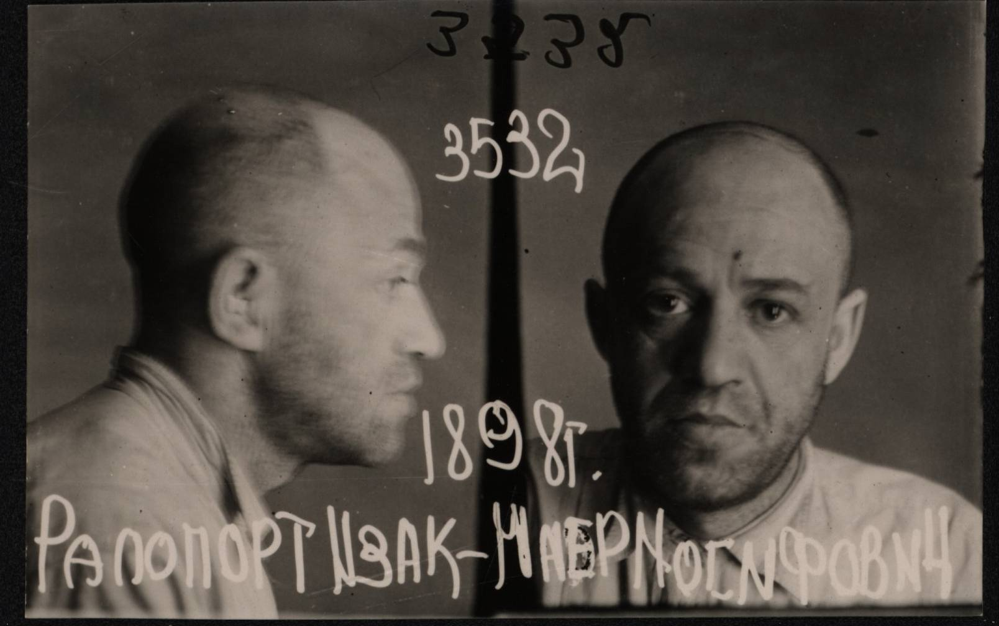

# Reluctant Wanderer

&nbsp;&nbsp; *This is the story of Isak-Majer Rapaport, born in 1898 in Rava-Ruska, son of a rabbi. [File No. DAZO f.2558-0297](https://archivkgb.zcu.cz/en/dazo/f2558/dazo_f_2558-0297)*

&nbsp;&nbsp; There was no more tea left in the cup, so Isak hesitated: should he take another cookie from the well-worn Bohemian crystal vase, or should he dab his lips with a napkin, thank his wife Maria for an excellent breakfast, and go downstairs to open the shop. His considerations were interrupted in a brutal manner by an insistent knocking at the door.

&nbsp;&nbsp; "Oy vey, who is it now?" The war in Europe had been going on for two years already, and such visits of the strangers to ordinary petty shopkeepers grew more ominous day by day. A pale, frightened maid conducted two men into the dining room: a tall one, imposing gendarme and a short, unremarkable gentleman wearing civilian. Considering how obsequiously the gendarme hung on every move the short gentleman made, the one represented the detective corps here. The host put his cup back on the table and rose to his feet in order to meet the strangers.

— Mr. Rapaport? — The one in civilian considered any introductions unnecessary. — Be so kind as to come with us. The police has questions to you.

— May I know your name and rank first? — Isak was fighting with everything he had to still the shaking in his body and his voice. He must not provoke the visitors, yet going with them calmly was terrifying. — Second, on what grounds are you going to take me anywhere?

&nbsp;&nbsp; In lieu of an answer, the one in civilian nodded to his companion. The gendarme stepped up to the host, drew his hand back slightly, and popped the host in the area of the liver — not hard, but with the precision of the person who knows this stuff. Isak clutched his stomach, desperately trying not to drop to the floor, while the detective continued to reason with him in the same calm voice:

— You should understand, out-subject Rapaport, — the detective placed special emphasis on that "out-subject," — that in your unenviable legal position I can do with you whatever I want to. However, I just merely wish to carry out a lawful order from my superior. Let's stop dilly-dally and get going already. I wouldn't want to miss my lunch.

&nbsp;&nbsp; He was eager to explain to the uninvited guests where they could shove all their superiors and the orders of the named superiors. Isak, having caught his breath, had already opened his mouth — but the detective's attentive gaze and the gendarme's arm drawn back anew for another pop allowed him to imagine what would happen next. Thus, Isak merely gasped out, as if apologizing for his insolence:

— I'm sorry, would I be allowed to pack my toothbrush?

— Three minutes. Miloš is assisting you. — The one in civilian shrugged indifferently.

&nbsp;&nbsp; Miloš followed the host into the bedroom, allowed him to pack a small travel bag, pulled out of the bag everything he didn't like — things such as a warm jacket and night pajamas — and then escorted the host outside. The bus was already waiting. The one which carried all three of them out of Tyachev.

&nbsp;

&nbsp; The police captain was a weather-beaten man of uncertain age. Contrary to Isak's expectations, the captain did not look like an almighty thunderer, like the one who demands to protect the ones and execute the others. With unbearable weariness, he shuffled through the papers scattered on his desk and then pulled one of them to the top. In a voice that suggested he had repeated all this for the twelfth time that morning, the captain fulfilled his duty to the Hungarian state:

— Good day, out-subject. Police Captain, Doctor Fikmoid. — He introduced the man for whose sake Isak had been dragged from his breakfast table and suffered all the way to Slatina [Solotvyno, Transcarpathia] by bus. The captain continued droning on, without any chance for Isak to answer. — Rapaport? Isak-Majer? Born 1898, Rava-Ruska? Of Jewish nationality, son of a rabbi? Shopkeeper from Tyachev? Wife, Maria, née Weiss, has three children: Bernard, Arel, and Samuel?

— I... — The captain cared little about what Isak wanted to say next. He continued with the same monotony:

— You are not a subject of the Hungarian King. Do you hold any other citizenships or allegiances?

— I don't...

— In accordance with the latest decree, you are required to leave the territory of Hungary within five days. Read the decree and sign here. If you're illiterate, make a mark.

&nbsp; Bewildered Isak signed where pointed to.

— Do you wish to file an appeal against the decision?

— Of course! — Isak's took heart. — Of course I do!

— As you wish. — The captain shrugged indifferently, handed him another form to sign, and with the same indifference called out to the duty officer:

— The next one!

&nbsp; The duty officer ushered in some Jew (Isak didn't recognize him), while firmly taking Isak by the shoulder and leading him out of the room.

— Where are they taking me? — howled Isak in despair. He still was not daring at least to wriggle.

— Where do you think? — For the first time during the entire conversation, the captain allowed himself any emotion: exactly, the astonishment. — Under arrest, pending the review of your appeal. You didn't think we'd let you run off wherever you please and hide from deportation for as long as you wish, did you?

&nbsp;

&nbsp; Isak spent five days in the cell. People, mostly Jews like himself, appeared and disappeared. Once a day, the man who was arrested for not having something he never had was given a bit of water and bread. Five days later, he was brought before the captain. The captain, in the same gray voice, informed him that his appeal had been rejected and that he, Isak, was decided to be deported to neighboring Romania. The captain cared little about what Isak thought about all of this. The duty officer cared even less. The unfortunate Isak, son of a rabbi, was put on the very same bus and sent back to Tyachev.

&nbsp; Isak perked up in vain at the sight of familiar landscapes. Instead of home, he was brought to the prison, though.

— Ah, there's my old pal... — One of the guards apparently knew Isak. He accompanied his verbal greeting with a welcoming jab to the ribs. — So, you say you won't serve on credit above three forints?

&nbsp; The dim lightbulb helped Isak to recognize one of his troublemaking customers. "Well, who could have known that one might someday it would be possible to get punched in the face for three forints?" — the merchant was full of regret.

— Hey, easy there, you know... — Reasoned the other guard to the first one. — Remember what happened to Řepa? He was found in the pond, neck broken, with six Stars of David carved into his body. Exactly as much as the men he had previously done in inside this exact cell. Leave him be.

— I'm not going to kill him. — The regular customer from the past snapped back. — But he must tell me, where his Jewish treasure is hidden. And then he'll be set free, with a clear conscience, as it's said in the Communists Russia.

&nbsp; The next morning, some soldiers doused him with water, not without difficulty set him on his feet, and dragged him somewhere outside the town, occasionally giving him a nudge to the right direction. About a kilometer away of the state border marker, the soldiers stopped. One of them quickly frisked the prisoner, pulled the watch off his wrist, scooped a handful of coins from his pocket, reflected for a moment, returned about a quarter of coins, and hid the rest in his own pickpocket.

— Romania is that way. — The second soldier waved his hand away from the town. Come back, and you'll be shot. Clear? Sign here to confirm that you understand, and get lost of my face!

&nbsp; Nothing was clear to the beaten and starving Isak. He had just enough power left to hobble further down the road into the terrifying unknown. When he dared to look back, the soldiers were already walking back toward Tyachev. Overwhelming loneliness and fear washed over the ordinary shopkeeper from an ordinary Czech town. Isak ran — ran as far as he could from this terrible world and its terrible soldiers.

&nbsp;

— Well, you're something else, my friend. — Isak with difficulty peeled open one eye and stared at a living skeleton just like himself, lying on the neighboring hospital bunk. The neighbor who hardly cared of Isak's suffering, continued: — When you stopped coming to, the day before yesterday, and started raving nonstop, even the orderly started doubting whether you might actually have real typhus. And what a journey our soldiers organized for you! Let's see, did I remember it right? From the border post they took you to Marmureș-Sighet, where you wasted five days. Then they brought you here, to Vișeu de Sus, where you spent another three days, and here in the hospital you've been for twelve days already. That makes twenty! — the sick man grinned with all fifteen or eighteen of his teeth, pleased with his mathematical talents.

— Twenty-one. — Isak corrected automatically. — I also spent a night at the border post.

— Well, you're a lucky one, I'll tell you that. — The bored neighbor wouldn't let up. — I heard that only the border guards have just received an order: Jews, Rusyns, and others — like Ukrainians, whom Hungary keeps pushing at us more and more — are no longer to be beaten or shot, but to be passed along to the Russians just the same manner. They've got their "intentionals" and whatnot over there. — Dropped a fancy word the companion of "rootless cosmopolitan" Rapaport.

— To the Russians? — Isak was horror-struck. Even if the Hungarian newspapers, following the Austrian and German ones, eagerly recounted how terribly the working people of the USSR lived under the heavy yoke of the Jews, the fragments of information reaching him from his parents in the recently "liberated" western Ukraine drawed a very different picture of the fate of Soviet Jews. And Isak was not eager to share the fate of many of his people. The only fact that his parents had stopped answering his letters — to avoid being arrested for espionage — said enough about the practices prevailing among the Bolsheviks.

— And would the gentleman prefer a voyage by luxury steamship straight to the blessed land of Palestine? You know, comrade, these are very bad times for your people in this part of the world. I will pray for you to survive.

— Wait, — Isak suddenly realized, — you're speaking to me in Hungarian...

— In nineteen-sixteen...

&nbsp; What exactly happened in nineteen-sixteen, Isak never found out, because the medical orderly walked into the barracks. The medic looked Isak over here and there, exchanged a few words in Romanian with the man on the neighboring cot, noted something down on his clipboard having a satisfied look, and marched away. After lunch, a soldier arrived — apparently summoned by the medical orderly — and Isak's tribulations began anew. The soldier led him to some village, then to a barracks in some backwoods. In the barracks, Isak was finally fed to his heart's content and allowed to sleep on a bench next to the stove. In the morning, three soldiers led him into the mountains, pointing somewhere with their rifle barrels. Isak even froze for a second, wondering whether he should go back to Romania? But one of the soldiers racked the bolt of his rifle, and Isak slouched away to the indicated direction.

&nbsp; And again, some cabin in the middle of nowhere, a deathly frightened bearded forester, soldiers taking him away again, another interrogation. Which one was it now? The sixth? The eighth? Investigator Grek. Investigator Karpov. Another transfer, this time to Stanislav. What does this semi-literate peasant in NKVD epaulets want from him? My family? Again?

— Wife, Maria, daughter of Abram, née Weiss... — The speech, repeated so many times, no longer required any effort from the exhausted brain. — Elder son, Bernard. My boy... — The last straw broke the camel's back. Thoughts, terrible thoughts about his family, all came at once, and there was no longer any way to sweep them back under the rug. "What will become of my dear Maria? And Bernard? My little Berchik. Such a talented boy. Will they all suffer the same fate as me? What if they're deported one by one? What if..." The most terrible "what if," fortunately, was never asked of himself: the former collective farmer turned NKVD man, enraged by the lack of reaction to his shouting, felled the prisoner with a single slap. Isak sobbed, unable to squeeze out a single syllable, let alone defend himself against the kicks of a heavy boot.

Out of breath, the interrogator of the investigative department, Sergeant of State Security Lyadsky, took some water straight from the jug, poured the rest over the face of Isak curled up on the floor, sat him back in the chair, and began anew.

&nbsp; Yes, his father was a rabbi. Yes, he was beaten. Yes, they took everything, except what he had hidden in the soles of his shoes. No, he didn't know what his brother did. Best to answer quickly and without hesitation — then they don't beat you. Yes, he knew he had crossed the border illegally. Yes, he would sign anything. The world around him went dark. All that remained was a gray mush before his eyes and the same thought pounding in his temples. "What if?"

&nbsp; Isak no longer paid attention on how the satisfied Sergeant Lyadsky rapped the handle of his Nagant revolver against the interrogation-room door and joyfully announced to someone: "Learn how it's done! Five years in the camps, a signed confession, and still a full twelve minutes before midnight! Let's see you rookies process someone faster!" The "rookies" responded with hooting from behind the door.

*This is where the file of Isak-Majer Rapaport ends. I do not know whether he survived his five years in the camps, how he lived afterward. Or perhaps his life, like the lives of thousands of unwilling guests of the Soviet country, ended in the basement of the Stanislav NKVD, where security officers maddened with fear shot witnesses to their own crimes before the even more insane Gestapo men could reach them on the shoulders of the all-devastating iron army of the Germans? I would like to believe that Isak-Majer Rapaport, by some miracle — in the chaos of the retreat of '41, perhaps — somehow obtained forged documents, passed himself off as a Hungarian subject, and made it to Turkey. Maybe with the help of the Bulgarian and Greek underground? Unfortunately, the KGB of the USSR possessed no such information. In 1992, the Ukrainian prosecutor's office overturned Rapaport's conviction due to the absence of a crime.*
